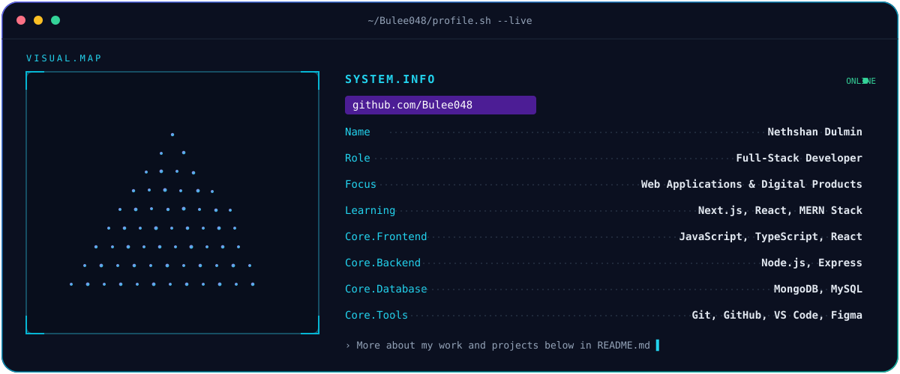

  

  

    
    
  

---

## `01` / SYSTEM.INFO

- **Name:** Nethshan Dulmin
- **Role:** Full-Stack Developer
- **Focus:** Building practical web applications and digital products
- **Currently exploring:** Next.js, React, and MERN Stack architectures
- **Interested in:** Open-source collaboration, problem-solving, and real-world software projects

I enjoy turning ideas into working products, building useful interfaces, and learning technologies that help create better software.

---

## `02` / TECH STACK

  

---

## `03` / PROJECTS.LIST

<table>
  <tr>
    <td width="50%" valign="top">
      <h3><a href="https://github.com/Bulee048/LeadFlow-CRM">LeadFlow CRM</a></h3>
      
A CRM lead-management application designed around sales workflows, a visual pipeline, analytics, and authentication.

      
<b>STACK</b> &nbsp; MERN · React · Node.js

    </td>
    <td width="50%" valign="top">
      <h3><a href="https://github.com/Bulee048/SwiftRoute-Project">SwiftRoute</a></h3>
      
A logistics and delivery management platform with real-time tracking, role-based dashboards, and map integration.

      
<b>STACK</b> &nbsp; MERN · Socket.IO

    </td>
  </tr>
  <tr>
    <td width="50%" valign="top">
      <h3><a href="https://github.com/Bulee048/School-Management-System">School Management System</a></h3>
      
An object-oriented school management application with Admin, Teacher, and Student modules.

      
<b>STACK</b> &nbsp; Java · JSP · MySQL

    </td>
    <td width="50%" valign="top">
      <h3><a href="https://github.com/Bulee048/SCC">Campus Operations Hub (SCC)</a></h3>
      
A campus operations platform bringing campus services, collaboration, and useful tools together.

      
<b>STACK</b> &nbsp; JavaScript · React

    </td>
  </tr>
  <tr>
    <td colspan="2" valign="top">
      <h3><a href="https://github.com/Bulee048/Public-Transportation-Management-System">Public Transportation Management System</a></h3>
      
An IoT-integrated transportation application featuring real-time bus tracking and RFID-based contactless fare payment.

      
<b>STACK</b> &nbsp; MERN · ESP32

    </td>
  </tr>
</table>

---

## `04` / GITHUB.ANALYTICS

  <picture>
    <source
      media="(prefers-color-scheme: dark)"
      srcset="https://github-readme-stats.vercel.app/api?username=Bulee048&show_icons=true&include_all_commits=true&hide_border=true&rank_icon=github&bg_color=0B1020&title_color=22D3EE&icon_color=A78BFA&text_color=C7D2E0"
    />
    
  </picture>
  <picture>
    <source
      media="(prefers-color-scheme: dark)"
      srcset="https://github-readme-stats.vercel.app/api/top-langs/?username=Bulee048&layout=compact&langs_count=8&hide_border=true&bg_color=0B1020&title_color=22D3EE&text_color=C7D2E0"
    />
    
  </picture>

    

  <picture>
    <source
      media="(prefers-color-scheme: dark)"
      srcset="https://streak-stats.demolab.com?user=Bulee048&hide_border=true&background=0B1020&stroke=164E63&ring=A78BFA&fire=22D3EE&currStreakLabel=22D3EE&sideLabels=94A3B8&currStreakNum=F8FAFC&sideNums=F8FAFC&dates=64748B"
    />
    
  </picture>

---

## `05` / CONTRIBUTION.MAP

  <picture>
    <source media="(prefers-color-scheme: dark)" srcset="https://raw.githubusercontent.com/Bulee048/Bulee048/output/github-contribution-grid-snake-dark.svg" />
    <source media="(prefers-color-scheme: light)" srcset="https://raw.githubusercontent.com/Bulee048/Bulee048/output/github-contribution-grid-snake.svg" />
    
  </picture>

---

## `06` / CONNECT

  
  

    

  <i>Building useful things, one commit at a time.</i>

